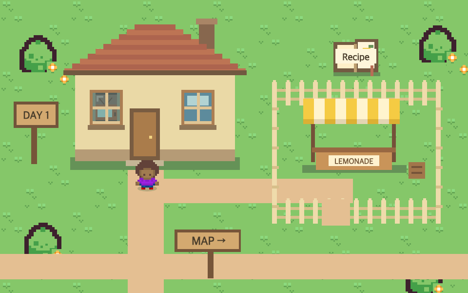
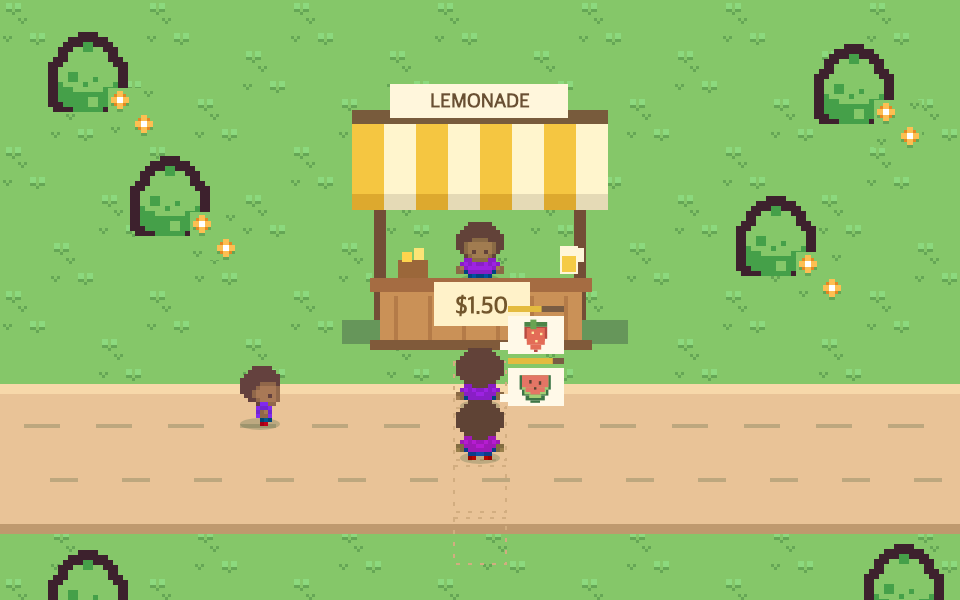
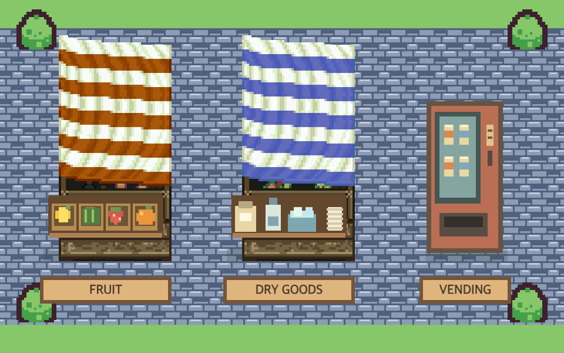
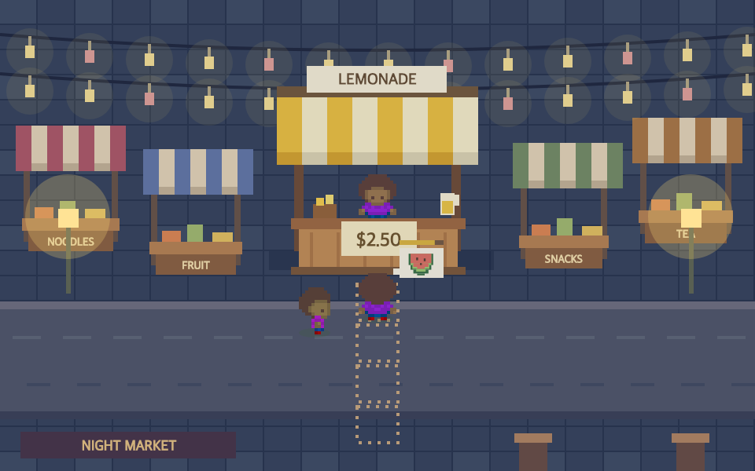

# Web Mini Games

A small hub with two sides: **Mini games** to play and **Life apps** for everyday things. The first game, **Lemonade Stand**, turns a command-line lab idea into an interactive 2D business simulation with pixel art, moving customers, and drinks made to order.

**[Explore the arcade](https://mini-arcade.mini-arcade-hub.workers.dev/)** · **[Play Lemonade Stand](https://lemonade-stand.mini-arcade-hub.workers.dev/)**

Play directly in your browser—no installation or account required.

## Order Dinner (点菜)

A dinner-ordering app at `/dinner/`. Anyone can browse the menu and fill a basket. The passcode is only asked for when placing an order:

- **With the passcode**, the order is sent to the shared order list, and the device remembers the passcode. Both people then see the same orders and shopping list on their own phones.
- **Without it**, the app works on its own: orders and the shopping list are kept only on that device.

- **Order from a preset menu.** Each dish can have flavor choices (spice, sweetness, add-ons), ingredients that can be left out, a note, and a number of servings.
- **DIY dishes.** Write a dish that isn't on the menu, with the ingredients it needs.
- **Shared orders.** Orders move from 已下单 to 在做了 to 开饭啦, and finished orders can be ordered again.
- **Shopping list.** Ingredients from unfinished orders are merged by name and unit and scaled by servings. Removed ingredients and pantry staples are left out, and either person can tick items or add extras.

The menu lives in [`src/apps/order-dinner/menu.ts`](src/apps/order-dinner/menu.ts). Edit it and redeploy to change dishes.

## The experience

The arcade is a hub: choose a game, view its introduction and gameplay previews, then launch its independent website. Lemonade Stand is playable today.

In Lemonade Stand, you start with **$15**, ten each of cups, lemons, sugar, and ice, plus five strawberries and five watermelon portions. Buy supplies at the market, choose where to sell, set your price, and prepare each customer's drink before they lose patience.

- **Make drinks on demand.** Click ingredients to prepare classic lemonade, Pink Lemonade, or Watermelon Lemonade. Customer bubbles show fruit orders; serving the wrong drink wastes the cup and earns no payment.
- **Learn customer preferences.** Balance sourness, sweetness, and ice. Satisfied customers leave tips, while price and waiting time affect whether they buy.
- **Plan around the weather.** Check the forecast on your home television. Weather and temperature influence foot traffic and demand; rainy scenes include rain and some customers carrying umbrellas.
- **Grow across the town.** Start at Lemon Lane and unlock the park, commercial street, and night market. Commercial customers have larger budgets and less patience; the busier night market charges a $50 stall fee.
- **Manage the business.** Shop at fruit and dry goods stalls, track inventory, pause or close early, and review sales, tips, and profit at the end of the day.

## Gameplay previews

| Home & town planning | Preparing customer orders |
| --- | --- |
|  |  |

| Market | Night market |
| --- | --- |
|  |  |

## Engineering highlights

- **Independent portal and game.** The Next.js portal and standalone game deploy separately, with launch and return links connecting them.
- **A reusable game registry.** Shared metadata drives game cards and introduction routes, making it straightforward to add more titles.
- **Modular game rules.** Simulation, customer taste, weather, locations, market purchases, and drink matching live in separate JavaScript modules, apart from the UI and drawing code.
- **Canvas-based 2D presentation.** Pixel scenes, customer movement, weather effects, and ingredient interactions run in the browser.
- **Tested game mechanics.** Automated tests cover inventory and cash accounting, tips, wrong orders, customer timeouts, pausing, early closing, weather, and location-specific rules.
- **Static pages with a small API.** Both websites run on Cloudflare Workers Static Assets. Gameplay runs entirely in the browser; only Order Dinner calls a Worker API (`worker/index.ts`) backed by Cloudflare D1, protected by a shared passcode.

## Technology

| Area | Stack |
| --- | --- |
| Arcade portal | Next.js App Router, React, TypeScript, Tailwind CSS |
| Lemonade Stand | JavaScript ES modules, HTML Canvas, CSS |
| Order Dinner | React client components, Cloudflare Worker API, Cloudflare D1 |
| Tests | Node.js built-in test runner |
| Hosting | Cloudflare Workers Static Assets, Wrangler |

## Run locally

```sh
npm ci
npm run dev
```

Open the arcade at `http://localhost:3000`.

To run the standalone game:

```sh
python3 -m http.server 3001 --directory standalone/lemonade-stand
```

Open `http://localhost:3001`.

To run the portal together with the Order Dinner API and a local D1 database, put a local passcode in `.dev.vars` (gitignored), then build and serve with Wrangler:

```sh
echo 'ORDER_PASSCODE="pick-a-local-passcode"' > .dev.vars
npm run dev:worker
```

Open `http://localhost:8787/dinner/`.

```sh
# Validate the portal, the Worker and all tests
npm run lint
npm run typecheck
npm test

# Build and publish the two websites independently
npx wrangler login
npm run deploy:arcade
npm run deploy:lemonade
```

Deployments are manual; pushing to GitHub alone does not publish a new version. `deploy:arcade` applies any new D1 migrations before deploying.

One-time setup for Order Dinner in production:

```sh
npx wrangler d1 create mini-hub-dinner   # only for a new account; put the printed database_id into wrangler.jsonc
npx wrangler secret put ORDER_PASSCODE   # the passcode both of you type on first open
```

## Current scope & next steps

This project is in active development. Game progress currently lasts for the browser session; refreshing starts a new game. The market vending machine is a placeholder for future functionality.

Next steps include persistent saves, more mini games, and expanded market items and town events.

## Asset credits

Third-party game assets retain their attribution and license files in [`standalone/lemonade-stand/assets`](standalone/lemonade-stand/assets). Preview credits are in [`public/previews/art-credits.txt`](public/previews/art-credits.txt), with market artwork licensing in [`public/previews/market-license.txt`](public/previews/market-license.txt).
